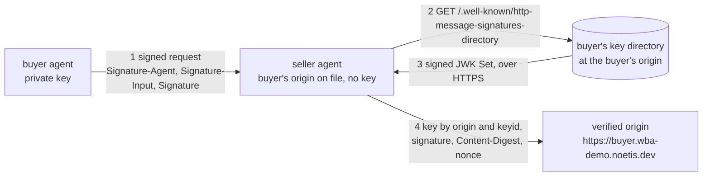
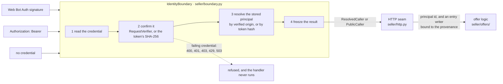
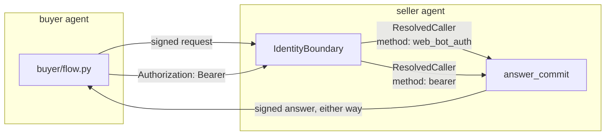
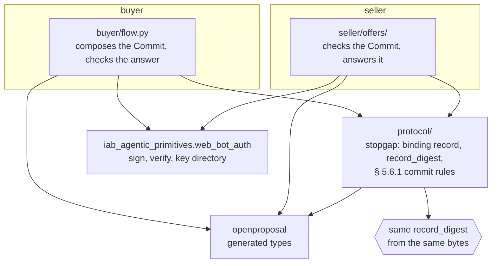
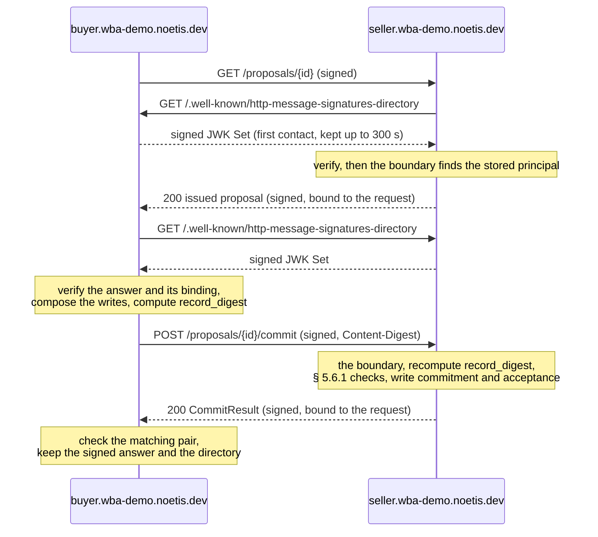
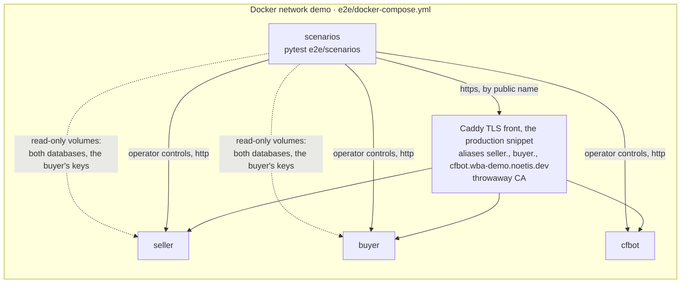
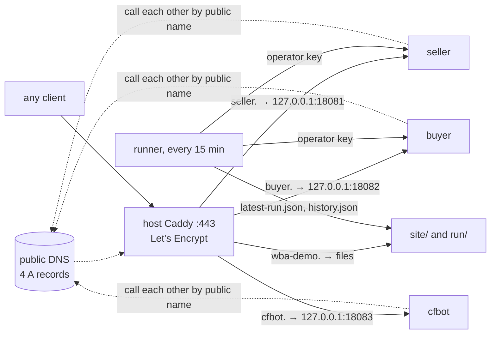

# OpenProposal Web Bot Auth demo

A buyer agent commits to an OpenProposal offer, and a seller agent accepts it.
Each agent learns who the other is from a signature it can verify, with no
shared secret and no key exchanged in advance. The same flow also runs with a
bearer token, and it reaches the same identity at the same boundary.

The demo runs live at [wba-demo.noetis.dev](https://wba-demo.noetis.dev), which
explains it with diagrams and shows the latest run's real signed messages. This
README covers the same ground for readers of the code:

- [Why Web Bot Auth](#why-web-bot-auth)
- [The identity boundary](#the-identity-boundary)
- [Bearer and Web Bot Auth interop](#bearer-and-web-bot-auth-interop)
- [One SDK, two parties](#one-sdk-two-parties)
- [The offer flow](#the-offer-flow)
- [Topology](#topology)
- [Scenarios](#scenarios)
- [Run it locally](#run-it-locally)
- [Deploy it](#deploy-it)
- [Where the pieces live](#where-the-pieces-live)

## Why Web Bot Auth

Agents that trade with each other must know who is calling. A bearer token
answers that with a shared secret: the seller issues it, the buyer presents it,
and whoever holds it is the buyer. That needs a setup step per pair of parties,
and it leaves no proof a third party can check.

[Web Bot Auth](https://datatracker.ietf.org/doc/draft-ietf-webbotauth-httpsig-protocol/)
signs each HTTP request with
[HTTP Message Signatures (RFC 9421)](https://www.rfc-editor.org/rfc/rfc9421).
An agent's identity is its origin, such as `https://buyer.wba-demo.noetis.dev`.
The agent publishes its public keys in a signed key directory at
`/.well-known/http-message-signatures-directory` on that origin, and signs
with its private key. A verifier reads the origin from the `Signature-Agent`
header, fetches the directory over HTTPS, and checks the signature, so TLS for
the host ties the keys to the domain. OpenProposal 3.0 § 2.8 profiles these
rules for agent traffic, and the seller signs its answers the same way.



## The identity boundary

A bearer token and a Web Bot Auth signature are both transport-level
credentials, and both solve the same problem: identifying the caller. The
seller confirms either one once, in [`IdentityBoundary`](seller/boundary.py),
resolves it to the principal stored in its own database, and passes a frozen
identity to the offer logic.

A party owns its identity, and a credential only points at it. The seller
knows its buyer as one principal ([`seller/seed.py`](seller/seed.py)), whose
domain is the host of the buyer's origin and whose legal name its settings
name. Two credentials point at it: the buyer's origin, for a signature, and
the hash of the token the seller issued the buyer. So one buyer is one
principal, whichever credential it presents, and a proposal it reads with one
credential it can commit to with the other. The principal's domain and legal
name are written once and never rewritten, because the proposals issued to it
name them: a boot whose settings name the buyer otherwise refuses to start
(`IdentityChanged`).



The code path, in order:

1. Each route declares `caller: CallerDep`, or, when it calls the offer
   logic, `principal: PrincipalDep` or `writer: EntryWriterDep`, and a route
   that reads the body declares `body: RawBodyDep`
   ([`seller/http.py`](seller/http.py)). FastAPI
   runs the boundary that `create_app` built ([`seller/app.py`](seller/app.py))
   before the handler. No route takes a `Request` or reads a header.
2. `IdentityBoundary.resolve` ([`seller/boundary.py`](seller/boundary.py))
   reads the presented credential and refuses a request that presents both,
   or more than one `Authorization` line.
3. A signature goes to the library's `RequestVerifier.verify`, which fetches
   the origin's directory through the resolver in
   [`transport/wba.py`](transport/wba.py) and checks `Content-Digest` against the
   body. The boundary then resolves the origin with `for_origin` (stored by
   [`seller/sqlite_store.py`](seller/sqlite_store.py)). It writes nothing.
4. A token is confirmed and resolved by one lookup, `for_token`, which matches
   its SHA-256. The seller never stores the token.
5. The boundary returns a frozen `ResolvedCaller` (a principal, and a
   `SignatureCredential` or a `BearerCredential`) or a `PublicCaller`. A verified
   origin with no row is an established identity with no principal: a
   `PublicCaller` that carries the signature. The types
   ([`seller/caller.py`](seller/caller.py)) are strict, frozen, and
   discriminated, and refuse an amended copy. A `ResolvedCaller` also carries
   its `Provenance` ([`persistence/values.py`](persistence/values.py)), which
   holds confirmed facts only: the principal id, the method, and, for a
   signature, the verified request (its signer names the signing origin, with
   the directory fetch it verified against and the instant it verified at) and
   whether the signature covers the body.
6. The offer logic ([`seller/offers/`](seller/offers)) never sees the caller.
   The HTTP seam hands it the principal id to read a proposal, and, to answer
   a commit, an `EntryWriter` (or None, for a caller with no principal) that
   it binds to the caller's provenance. The offer logic reads only the
   writer's principal id. It writes the buyer's entry through the writer, in
   its transaction, with the `buyer.domain` of the issued record the entry is
   about, and the writer computes there whether the signature attributes the
   entry to that party (§ 4.1.2): against the record, never against the
   principal, as the buyer does for the seller's answer. Storage keeps the
   provenance and, for a signature, the signed request through the one
   `EvidenceStore` in [`persistence/evidence.py`](persistence/evidence.py), in
   the same transaction. A request that writes no entry leaves no evidence.
   The offer logic can't import an identity type or the provenance
   (`ruff-domain.toml`), so no offer decision depends on the credential.

A credential that fails is refused at the boundary, before anything parses the
body (the boundary reads it, because the signature covers it through
`Content-Digest`). It's never downgraded to "no credential", and the refusal is
a transport status with no `errors[]` object:

| Status | When | The answer also carries |
| :--- | :--- | :--- |
| `400` | A signature field doesn't parse, or the request presents two credentials (a signature and a token, or two `Authorization` lines) | Nothing more |
| `401` | A bearer token matches no row, or `Authorization` isn't a Bearer token | `WWW-Authenticate` |
| `403` | A signature fails verification or a profile rule | `Accept-Signature` |
| `429` | A signature's nonce was seen before | `Accept-Signature` |
| `503` | The verifier can't record the nonce | `Retry-After` |

The seller signs every agent-facing answer with `ResponseSigningMiddleware`,
refusals included, and binds it to the request it answers. The same middleware
serves the seller's signed key directory, and it checks when the app is built
that the directory lists the key it signs with.

## Bearer and Web Bot Auth interop

The same flow runs with either credential. The buyer picks one per call
([`buyer/credentials.py`](buyer/credentials.py)): `SignWith` signs the request
with `WebBotAuth(signer, verifier, expect=seller)`, and `Bearer` sends the
token with `WebBotAuth.verify_only(verifier, expect=seller)`. Either way the
buyer verifies the seller's signed answer against the origin it knows the
seller by. On the seller, both reach the same principal, the same
`ResolvedCaller` type, and the same offer code; only the method differs, and
the offer logic never sees it.

The buyer mirrors the seller's boundary
([`buyer/seller_client.py`](buyer/seller_client.py)). Its one client to a
seller verifies each answer, then parses it as the document its status says it
is (a `Proposal`, a `CommitResult`, or a § 2.4 `errors[]`), inside one refusal
boundary. A proposal must name the seller it called and the buyer's own party
(its `SELF_ORIGIN` host and its legal name, from its settings): one that names
another buyer is refused `wrong-buyer`, so the buyer never agrees to a record
that doesn't name it. An answer whose signature doesn't verify is refused whatever its
status: a failing signature with the library's reason, never taken as no
signature, and an unsigned answer, such as a proxy's `502`, as
`signature-missing`. An answer that fails either step comes back as a refusal,
never as an exception, and the buyer keeps nothing from it. The buyer's operator routes
answer a discriminated `Outcome` ([`transport/control.py`](transport/control.py)):
`read`, `agreed`, `rejected` (the seller said no), or `refused` (the buyer said
no, with its reason).



What Web Bot Auth adds over a bearer token:

| Property | Bearer token | Web Bot Auth signature |
| :--- | :--- | :--- |
| Setup before the first call | The seller issues a token and sends it to the buyer | None: the seller records the buyer's origin, and keys come from the buyer's directory |
| Shared secret | The token; whoever holds it is the buyer | None: the directory holds public keys only |
| Body covered | No | Yes, through `Content-Digest` |
| Replay of a captured request | Works until the token is revoked | Refused: each signature has a nonce and lasts at most 300 s |
| Evidence a third party can check | None: either party could have sent the request | The signed message and the directory bytes it verified against |
| Key rotation | Both parties coordinate a new token | The signer publishes a key, waits out caches, and switches; the verifier does nothing |
| Identity the boundary returns | The buyer's principal, `method: bearer` | The same principal, `method: web_bot_auth` |

## One SDK, two parties

The buyer and the seller import the same generated OpenProposal SDK
(`openproposal`, vendored in [`vendor/openproposal-sdk/`](vendor/openproposal-sdk))
and the same Web Bot Auth library (`iab_agentic_primitives.web_bot_auth`). Every
document either party reads or writes is a type from the SDK: `Proposal`,
`LineItem`, `LineItemWrites`, `Commit`, `CommitResult`, `AssentEntry`, and
`ErrorObject`. Their business logic differs, and everything they must agree on
is the same code.



An agreement holds only if both parties compute the same `record_digest`: the
SHA-256 of the binding record in RFC 8785 canonical form. A party that parses a
field differently, drops an unknown member, or writes a number another way
computes a different digest, and the seller answers `record_mismatch`. The same
holds for signatures: two verifiers that read the profile differently accept
different messages. A generated SDK removes that risk at the source. Every
party, in every language, gets types generated from one schema, and the
library does the same for signing and verification. Scenario 1 and every live
run check it: both parties hold byte-identical digest input and the same
`record_digest`.

**`protocol/` is the one stopgap.** The generator emits the types but not yet
the rules that work over them: the § 4.1.1 binding record and `record_digest`,
the § 3.4 buyer writes they compose over, and the § 5.6.1 rules that tie a
`Commit`'s members together. [`protocol/`](protocol) holds those, typed on the
generated classes, and both parties call it, so each rule has one
implementation. The binding record works over the raw JSON, never a parsed
value, so members a receiver doesn't know still count. When the schema tooling
emits these helpers, both parties import them from `openproposal` and the
package is deleted.

cfbot ([`cfbot/`](cfbot)) is the counterpoint: an agent on Cloudflare's
`web-bot-auth` library in Node. It shares no code with the other two, and it
proves interop with a second implementation of the same profile.

## The offer flow



The seller ([`seller/offers/`](seller/offers)) shows an issued proposal only
to its buyer, recomputes `record_digest` over the line items plus the commit's
writes, runs the § 5.6.1 checks in order (`checks.py`: one named step each,
the first that rejects decides), and answers a replay with the same
`idempotency_key` from its stored result (`ledger.py`). `answer_commit`
(`acceptance.py`) decides and stores in one transaction and returns its
answer, a `CommitResult` or a rejection, which
[`seller/http.py`](seller/http.py) renders as `{"errors": [...]}` with the
§ 2.4 status. A control-plane failure (the operator key, a control route's bad
input, a route the seller doesn't have) is `{"error": ..., "detail": ...}`. The buyer
([`buyer/flow.py`](buyer/flow.py)) runs the same protocol operations in
order: read, `compose_commit`, commit, `check_result`, and keep the agreement.
It re-sends a pending `Commit` whole until the seller's answer verifies, and it
settles a commit as rejected only on a stored rejection (`retry` other than
`same`). Both parties keep the counterparty's signed message
as exact bytes, with the exact directory bytes it verified against and the
instant it verified the message, so the evidence verifies again offline
(§ 4.1.2). Verifying it again is a function of the kept row alone: the
directory is checked at its `fetched_at` and the message at its `verified_at`,
so a record still verifies long after its signatures expired. The buyer keeps
its own request as the wire carried it, the URL as encoded and signed.

## Topology

### Local end-to-end test



Every container trusts the public roots plus the throwaway CA. The seller's
cache lifetime is 20 s and the buyer serves its directory with `max_age=0`, so
the rotation scenario waits only the profile's 300 s before the new key signs.

The Python image has two stages ([`Dockerfile`](Dockerfile)). The `base` stage
is what the seller, the buyer, and the live runner run: it runs as the user
`app` and holds no test code. The `scenarios` stage adds `e2e/scenarios` and
the dev group to it, and only the `scenarios` service builds it. The
scenarios read their settings, the stack's addresses, and their helpers from
[`e2e/scenarios/stack.py`](e2e/scenarios/stack.py); `conftest.py` holds only
their fixtures.

### Live deployment



The agents trust public roots only, and they reach each other through public
DNS and Caddy, like any outside party. Each agent keeps its signing keys and
its database on separate volumes. The live runner
([`runner/main.py`](runner/main.py)) mounts only the two database volumes,
read-only, and reads them through the read models in
[`persistence/observe.py`](persistence/observe.py), so it holds no agent's
signing key. The e2e `scenarios` service is the only one that mounts the
buyer's keys, so that a scenario can sign what the buyer never would.

## Scenarios

The `scenarios` service ([`e2e/scenarios/`](e2e/scenarios)) runs these in order against a
fresh stack:

| # | Scenario | What it proves |
| :--- | :--- | :--- |
| 1 | First contact by signature | Neither party has the other's key. The buyer commits; the seller fetches the buyer's directory, verifies, and resolves its principal. Both sides reach `agreed`. Each keeps the counterparty's message as exact bytes with the directory it verified against, and that evidence verifies again offline. Both hold the same digest input and `record_digest`. |
| 2 | Bearer token | The token and the signature resolve the same principal, which both of the buyer's credentials point at in the seller's records. The buyer commits with the token to the proposal it committed to by signature in scenario 1, and the commit is agreed with no signature evidence. |
| 3 | Tampered body | A body changed after signing gets `403 content-digest` from the boundary. Nothing is written. |
| 4 | Replay | The same signed request sent twice gets `200`, then `429 nonce-replayed`. |
| 5 | Unknown key | The buyer's origin with a key its directory doesn't list gets `403 key-not-found`. |
| 6 | cfbot | A request signed with Cloudflare's library verifies and resolves to a `PublicCaller` with cfbot's origin, key, and `body_covered`, and the seller keeps no evidence for it. cfbot can't read the buyer's issued proposal (`404 not_found`) or commit to it (`403 not_eligible`). |
| 7 | Cloudflare verifies the buyer | cfbot verifies a request the buyer signed, with `web-bot-auth`'s `verify()`, after fetching the buyer's directory and verifying the directory's own signature by that key with `http-message-sig`. |
| 8 | No credential | A commit with no credential gets `403 not_eligible`. An invalid token gets `401`, never "no credential". A failing credential is refused at the boundary even with a body that isn't JSON. |
| 9 | Buyer refuses an unverifiable answer | With the seller's test-only fault toggle, the buyer refuses an unsigned answer, an unbound one, one bound to another request, and one whose `Content-Digest` doesn't match its body, on a read and on a commit, by signature and by bearer token (a bearer request has no signature to bind to, so only the unsigned and the wrong-digest answers apply). On a commit, the seller accepted on the first attempt; each re-sent `Commit` keeps its `idempotency_key`, the seller answers from its stored result and writes no second entry, and the buyer agrees once the answer verifies. |
| 10 | Key rotation | The standard order. The buyer publishes a new key and keeps signing with the old one, which the seller accepts. Once no verifier can still hold a copy without the new key, it switches; the seller fetches the directory again and accepts the new key. Once the old key's signatures have expired the buyer removes it, and after the seller's next refresh a request signed with it gets `403 key-not-found`. The wait is derived from the directory's `Cache-Control: max-age` plus the profile's 300 s cache lifetime (§ 2.8.3), never set apart from it: the stack serves `max-age=0` and waits 300 s, and production waits 600 s. |
| 11 | Operator controls | The front never routes an agent's own controls (`/operator/`, cfbot's `/run/`), and each agent refuses a call without its own `OPERATOR_KEY`, another party's included. The seller issues a fresh proposal on an operator call, which the live runner uses. |

## Run it locally

You need Docker with Compose, and [uv](https://docs.astral.sh/uv/). The
repository vendors the Web Bot Auth library it pins (see
[Where the pieces live](#where-the-pieces-live)), so a clone installs on its
own: `uv sync --locked --group dev`.

To run the behavior tests, run `make test`.

To build the stack, run every scenario, and tear it down, run the following
command:

```bash
make e2e
```

The script writes a throwaway CA, a leaf for `*.wba-demo.noetis.dev` and
`wba-demo.noetis.dev`, a random bearer token, and a random operator key for
each agent to `e2e/generated/`, which is gitignored.

To drive the stack by hand, start it and call the buyer's operator trigger from
inside the network:

```bash
cd e2e
uv run --project .. python gen_demo_tls.py
python3 ../deploy/local_caddy.py ../deploy/Caddyfile.snippet generated/Caddyfile
mkdir -p generated/logs
compose=(docker compose --env-file generated/demo.env)
"${compose[@]}" up --detach --wait seller buyer cfbot front
"${compose[@]}" run --rm scenarios python -c "import os, httpx; print(httpx.post(
    'http://buyer:8000/operator/commit', headers={'X-Operator-Key': os.environ['BUYER_OPERATOR_KEY']},
    json={'proposal_id': 'demo-wba-1', 'line_item_ids': ['business-daily-display']}).text)"
"${compose[@]}" --profile test down --volumes
```

To rehearse the live deployment on your machine, run `make live-local`. It
starts [`deploy/docker-compose.prod.yml`](deploy/docker-compose.prod.yml) with
a local override that stands in for public DNS and Let's Encrypt, serves the
production [Caddy snippet](deploy/Caddyfile.snippet) in a container, runs the
live runner once, and checks that the site serves its report.

## Deploy it

[`deploy/README.md`](deploy/README.md) has the exact steps: copy the
repository to the host, write the secrets with `deploy/make-env.sh`, start
`deploy/docker-compose.prod.yml`, add `deploy/Caddyfile.snippet` to the host's
Caddy, and create the DNS records. It also covers teardown.

The live deployment differs from the local test only where production needs it:

| Setting | Party | Live | Local end-to-end test |
| :--- | :--- | :--- | :--- |
| TLS | Both | Let's Encrypt, through the host's Caddy | A throwaway CA, through a Caddy container that serves the same snippet |
| Trust store | Both | Public roots only | Public roots plus the throwaway CA |
| Directory `Cache-Control: max-age` | Seller | 300 s | 300 s |
| Directory `Cache-Control: max-age` | Buyer | 300 s | 0 s |
| Verifier `max_cache_age` | Seller, for the buyer's directory | 300 s | 20 s |
| Verifier `max_cache_age` | Buyer, for the seller's directory | 300 s | 300 s, the library's default |
| Wait before a published key signs | Buyer | 600 s, max-age plus 300 s | 300 s, max-age plus 300 s |
| Request signature lifetime | Buyer | 300 s | 10 s |
| Response signature lifetime | Seller | 300 s, the library's default | 300 s, the library's default |
| Fault toggle | Seller | Not mounted | Mounted for scenario 9 |

## Where the pieces live

- **The Web Bot Auth library**: the `iab_agentic_primitives.web_bot_auth`
  module of [`iab-agentic-primitives`](https://github.com/KonstantinMirin/iab-agentic-primitives-wba/blob/feat/web-bot-auth/WEB_BOT_AUTH.md), documented in its
  `WEB_BOT_AUTH.md`. Every signature, verification, directory, and fetch rule
  comes from it. The demo pins commit
  `3d76d7216c8c61ceddde976078c91b37c6b3e37f` of the `refactor/wba-architecture`
  branch of
  [`iab-agentic-primitives-wba`](https://github.com/KonstantinMirin/iab-agentic-primitives-wba),
  vendored unchanged in
  [`vendor/iab-agentic-primitives/`](vendor/iab-agentic-primitives) and
  installed through a uv path source in [`pyproject.toml`](pyproject.toml).
  Its [`VENDORED.md`](vendor/iab-agentic-primitives/VENDORED.md) has the one
  command that refreshes the copy. Once that commit is published, pinning it as
  a git source is a one-line change to `[tool.uv.sources]`:
  `iab-agentic-primitives = { git = "https://github.com/KonstantinMirin/iab-agentic-primitives-wba", rev = "<sha>" }`.
- **The specification**: [OpenProposal 3.0](https://github.com/IABTechLab/OpenProposal/pull/142). The demo follows § 1.2
  (identity layers), § 2.8 (the Web Bot Auth profile), § 4.1.1 (binding
  record), § 4.1.2 (assent and signed-message evidence), § 4.3 (issued
  proposals), and § 5.6.1 (`Commit` and `CommitResult`). The seller's seed
  proposal ([`seller/seed/proposal.yaml`](seller/seed/proposal.yaml)) is
  adapted from `examples/proposal-issued.yaml`.
- **The OpenProposal types**: the Python SDK generated by
  [`openproposal-schema`](https://github.com/KonstantinMirin/openproposal-schema/tree/18d0e8ec23e790e8ad5e066f2b8bc2fe2b1dc9c2/sdk/with-our-stack/python)
  for the stack's final text (the `with-our-stack` lock, as-written variant),
  vendored unchanged in [`vendor/openproposal-sdk/`](vendor/openproposal-sdk),
  whose `pyproject.toml` records the source commit.
- **The protocol stopgap**: [`protocol/`](protocol), the binding record,
  `record_digest`, and the § 5.6.1 commit rules, until the generator emits them.
- **cfbot**: [`cfbot/`](cfbot), a Node service on `web-bot-auth@0.2.0` and
  `http-message-sig@0.3.0`, pinned in its lockfile.
- **The explainer site**: [`site/`](site), plain HTML and CSS with inline SVG.
  [`site/run.js`](site/run.js) renders the runner's `latest-run.json`.

## What the demo leaves out

- **Address policy.** A production deployment injects an SSRF-guarded client
  into the directory resolver; the demo doesn't, because address policy is
  outside what it demonstrates.
- **Offer judgment.** The seller accepts every commit that passes the § 5.6.1
  checks. It doesn't check buyer values against the declared option space
  (§ 3), and it keeps one version per proposal.
- **Shared state.** The nonce store and the directory cache are in memory, in
  one process.
- **Distinct parties.** All agents sit under `noetis.dev`, so `Party.domain`
  stores each agent's host. Real parties have distinct registrable domains
  (§ 2.2), and § 4.1.2 attributes an entry by the party's domain.
