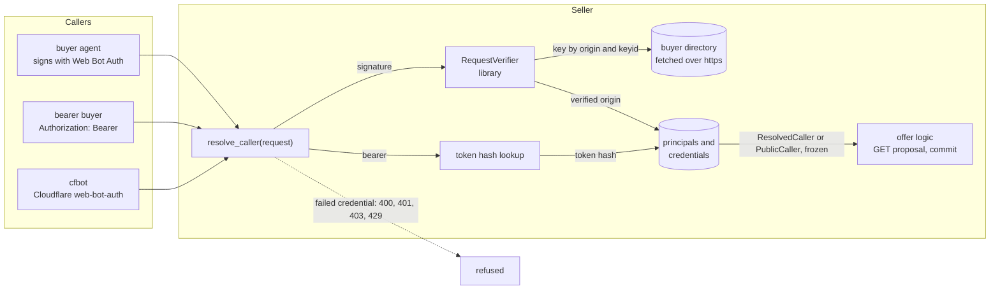
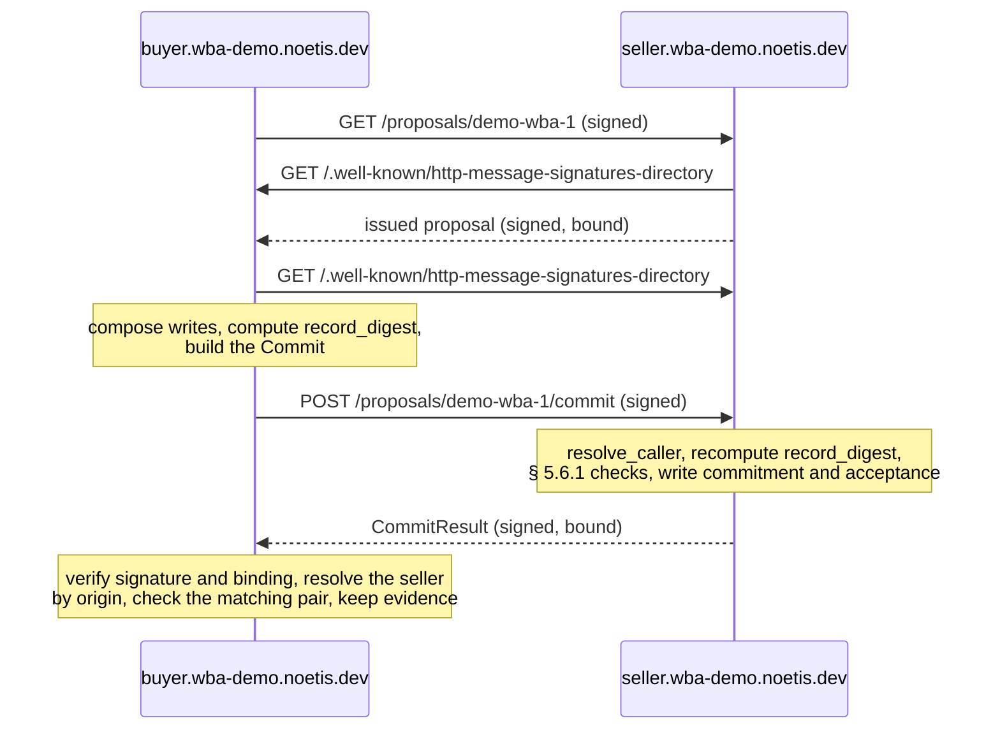

# OpenProposal Web Bot Auth demo

This repository shows one idea. A bearer token and a Web Bot Auth (WBA)
signature are both transport-level credentials. A party checks either one once,
at one identity boundary. The boundary resolves the confirmed credential to the
identity stored in that party's own database, and it passes a frozen identity to
the real logic.

Here, the real logic is OpenProposal offer acceptance: a buyer commits to a
proposal the seller issued to it, and the seller accepts. The signed messages
that carry each party's `assent[]` entry are kept as evidence.

The demo proves the following, end to end, over TLS, between agents that start
with no knowledge of each other's keys:

- The seller learns the buyer's keys only from the buyer's own key directory,
  and maps the verified origin to the principal in its database.
- A bearer token and a signature resolve to the same frozen identity type. The
  offer logic never sees which credential it was: the boundary puts the method,
  the evidence it kept, and the § 4.1.2 attribution in one `Credential` record,
  which the offer logic hands to storage with the entry, unread.
- A credential that fails is refused at the boundary. It's never downgraded to
  "no credential", and the handler never runs.
- Both parties compute the same `record_digest`, keep the same agreed record,
  and keep the counterparty's signed message with the directory it verified
  against: the exact message bytes, and the exact directory bytes with that
  fetch's own signatures, from the library's `VerifiedDirectory`.
- Cloudflare's `web-bot-auth` library accepts the buyer's signatures, and the
  seller verifies an agent built on that library.

## The identity boundary



[`seller/identity.py`](seller/identity.py) holds the boundary. It reads the
credential the caller presented, confirms it, resolves it in the seller's own
records, and returns one frozen value:

| Presented | Confirmed by | Resolved by | Result |
| :--- | :--- | :--- | :--- |
| A `web-bot-auth` signature | The library's `RequestVerifier`, which fetches the origin's directory and checks `Content-Digest` against the body | The `credentials` row with that origin | `ResolvedCaller`, `credential.method: web_bot_auth` |
| The same, from an origin with no row | The same | No row | `PublicCaller` with the verified origin: identity established, no principal |
| `Authorization: Bearer` | The token's SHA-256 matching a `credentials` row | That row | `ResolvedCaller`, `credential.method: bearer` |
| Nothing | Nothing | Nothing | `PublicCaller` with no origin |

A signature that fails verification gets the library's status (`400`, `403`, or
`429`), and a token that matches no row gets `401`. The boundary runs before
anything reads the body, so a failing credential is refused even when the body
isn't JSON. Routes ask for the caller with `caller: CallerDep` and never read a
header. Every agent-facing response is
signed with `ResponseSigner` and bound to the request it answers, refusals
included.

## The offer flow



The seller ([`seller/offers.py`](seller/offers.py)) shows an issued proposal only
to its buyer, recomputes `record_digest` over the line items plus the commit's
writes, runs the § 5.6.1 checks, and answers a replay with the same
`idempotency_key` from its stored result. The buyer
([`buyer/flow.py`](buyer/flow.py)) re-sends a pending `Commit` whole until the
seller's answer verifies. Both sides share the § 4.1.1 record rules in
[`shared/record.py`](shared/record.py), which use the `rfc8785` package for the
canonical form. [`tests/test_record.py`](tests/test_record.py) checks them
against the `record_digest` values in the specification's examples.

## Run the demo

You need Docker with Compose, and [uv](https://docs.astral.sh/uv/). The
[`iab-agentic-primitives`](#where-the-pieces-live) checkout must sit next to this
repository, at `../iab-agentic-primitives`.

To build the stack, run every scenario, and tear it down, run the following
command:

```bash
make e2e
```

The script writes a throwaway CA, a wildcard leaf for `*.wba-demo.noetis.dev`,
and a random bearer token to `e2e/generated/`, which is gitignored.

To run the unit tests, run `make test`.

To drive the stack by hand, start it and call the buyer's operator trigger from
inside the network:

```bash
cd e2e
uv run --project .. python gen_demo_tls.py
docker compose up --detach --wait seller buyer cfbot front
docker compose run --rm runner python -c "import httpx; print(httpx.post(
    'http://buyer:8000/operator/commit',
    json={'proposal_id': 'demo-wba-1', 'line_item_ids': ['business-daily-display']}).text)"
docker compose --profile test down --volumes
```

## Scenarios

The runner ([`e2e/scenarios/`](e2e/scenarios)) runs these in order against a
fresh stack.

| # | Scenario | What it proves |
| :--- | :--- | :--- |
| 1 | First contact by signature | Neither party has the other's key. The buyer commits; the seller fetches the buyer's directory, verifies, and resolves its principal. Both sides reach `agreed`. Each keeps the counterparty's message as exact bytes with the directory it verified against, and that evidence verifies again offline. Both hold the same digest input and `record_digest`. |
| 2 | Bearer token | A token resolves the same `ResolvedCaller` type as a signature, with `credential.method: bearer`. The commit is agreed with no signature evidence. |
| 3 | Tampered body | A body changed after signing gets `403 content-digest` from the boundary. Nothing is written. |
| 4 | Replay | The same signed request sent twice gets `200`, then `429 nonce-replayed`. |
| 5 | Unknown key | The buyer's origin with a key its directory doesn't list gets `403 key-not-found`. |
| 6 | cfbot | A request signed with Cloudflare's library verifies and resolves to a `PublicCaller` with cfbot's origin. cfbot can't read the buyer's issued proposal (`404 not_found`) or commit to it (`403 not_eligible`). |
| 7 | Cloudflare verifies the buyer | cfbot verifies a request the buyer signed, with `web-bot-auth`'s `verify()`, after fetching the buyer's directory and verifying the directory's own signature by that key with `http-message-sig`. |
| 8 | No credential | A commit with no credential gets `403 not_eligible`. An invalid token gets `401`, never "no credential". A failing credential is refused at the boundary even with a body that isn't JSON. |
| 9 | Buyer refuses an unverifiable answer | With the seller's test-only fault toggle, the buyer refuses an unsigned answer, an unbound one, and one bound to another request. The seller accepted on the first attempt; each re-sent `Commit` keeps its `idempotency_key`, the seller answers from its stored result and writes no second entry, and the buyer agrees once the answer verifies. |
| 10 | Key rotation | The buyer adds a key and signs with it; the seller fetches the directory again and accepts the new key. The buyer retires the old key. The seller accepts the old key while its cached directory is valid, then refuses it after the cache expires. |

## Where the pieces live

- **The Web Bot Auth library**: the `iab_agentic_primitives.web_bot_auth`
  module of [`iab-agentic-primitives`](https://github.com/IABTechLab/iab-agentic-primitives),
  documented in its `WEB_BOT_AUTH.md`. The module is offered to IAB Tech Lab
  and isn't merged yet, so this demo depends on a local checkout through a uv
  path source in [`pyproject.toml`](pyproject.toml). Every signature,
  verification, directory, and fetch rule comes from it.
- **The specification**: OpenProposal 3.0, `spec/openproposal-3.0.md` in
  [IABTechLab/OpenProposal](https://github.com/IABTechLab/OpenProposal), at the
  tip of the open pull-request stack. The demo follows § 1.2 (identity layers),
  § 2.8 (the Web Bot Auth profile), § 4.1.1 (binding record), § 4.1.2 (assent
  and signed-message evidence), § 4.3 (issued proposals), and § 5.6.1 (`Commit`
  and `CommitResult`). The seller's seed proposal
  ([`seller/seed/proposal.yaml`](seller/seed/proposal.yaml)) is adapted from
  `examples/proposal-issued.yaml`.
- **The OpenProposal types**: the Python SDK from
  [`openproposal-schema`](https://github.com/KonstantinMirin/openproposal-schema/tree/main/sdk/proposed/with-open-prs/python),
  vendored unchanged in [`vendor/openproposal-sdk/`](vendor/openproposal-sdk).
- **The stack types stopgap**: the SDK doesn't yet generate the stack's
  `Commit`, `CommitResult`, and `AssentEntry`, so
  [`demo_types/stack.py`](demo_types/stack.py) defines those three by hand.
  It's a stopgap. When the schema pipeline generates the stack's types, that
  module is deleted.
- **cfbot**: [`cfbot/`](cfbot), a Node service on `web-bot-auth@0.2.0` and
  `http-message-sig@0.3.0`, pinned in its lockfile.

## What the demo leaves out

- **Address policy.** A production deployment injects an SSRF-guarded client
  into the directory resolver; the demo doesn't, because address policy is
  outside what it demonstrates.
- **Offer judgment.** The seller accepts every commit that passes the § 5.6.1
  checks. It doesn't check buyer values against the declared option space
  (§ 3), and it keeps one version per proposal.
- **Shared state.** The nonce store and the directory cache are in memory, in
  one process.
- **Distinct parties.** Both parties sit under `noetis.dev` for the demo, so
  `Party.domain` stores each agent's host. Real parties have distinct
  registrable domains (§ 2.2), and § 4.1.2 attributes an entry by the party's
  domain.
